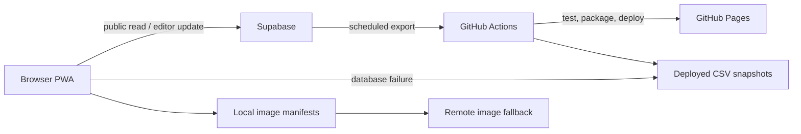

# Architecture

## System overview

Ultimate Pokemon Card Tracker is a zero-build static Progressive Web App. GitHub
Pages serves `public/`; Supabase supplies the live catalogue and quantities;
checked-in CSV exports provide a read-only outage and recovery path.

## Runtime components

- `index.html` and `tracker.html` are static entry points. Classic JavaScript
  files provide set selection, filtering, exports, authentication, and editing.
- `sets.js` is the configuration registry. Its key joins the database `set_id`,
  `backups/<set-id>.csv`, and `img/<set-id>/` namespaces.
- `supabase-client.js` is the only database adapter in the browser. The public
  key is intentionally distributable; RLS is the authorization boundary.
- The service worker caches the application shell. CI replaces its version
  placeholder with the deploying commit so releases invalidate old caches.

## Data and image flow

The tracker requests `pokemon_card_main` ordered by `sort_order`. On a request
failure it loads the packaged CSV snapshot and disables editing. An authenticated
editor can update only quantity; a database trigger records the before/after
values in `pokemon_card_quantity_history`.

Images resolve in this order: exact local manifest mapping, database
`image_url`, configured Pokemon API fallbacks. Local lookup normalizes cosmetic
differences but retains card, collector number, and variant as the identity.

## Delivery and operations

Pull requests run static checks, JavaScript/Python/browser tests, SonarQube,
CodeQL, dependency review, and produce a reviewable preview artifact. The main
pipeline packages root snapshots into the Pages artifact, deploys that immutable
artifact, and smoke-tests production. Releases use the exact deployed artifact,
add a checksum and SPDX SBOM, attest both, verify a draft, then publish it.

Daily backup and release-changelog updates use protected generated PRs. Weekly
canaries test production, Supabase, logos, and CSV recovery. Rollback redeploys a
retained successful Pages artifact rather than rebuilding an old revision.

## Trust boundaries and failure modes

- Database authorization lives in RLS, not hidden UI controls.
- Remote content and URLs are untrusted and require safe DOM/image handling.
- GitHub secrets are available only to trusted workflow jobs with narrow
  permissions; pull-request code must not receive them.
- A Supabase outage degrades to a read-only snapshot. A remote image outage
  degrades to another provider or placeholder. A bad deployment is recovered by
  artifact rollback; stale clients recover through service-worker versioning.

Architecture-changing work should add or supersede a record in
[`decisions/`](decisions/README.md).

